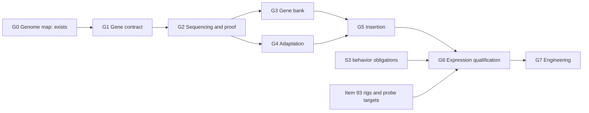

# Feature genome: extracting and inserting mod features

**Status: approved by the owner 2026-11-17 ("all approved"). Updated 2026-11-23: 94.G1 is done (WP1 to WP6, 2026-11-19) and 94.G2 is done (2026-11-23: all four pilots proven on both boot halves); 94.G3 has started (slices 1 and 2 of 3 done, 2026-11-23 and 2026-11-25, and slice 3a, 2026-11-26; `docs/GENE_BANK_DESIGN.md`); 94.G4 to 94.G7 are not started (ROADMAP-3 item 94).** Requested 2026-11-17: "design roadmap from
now to endgoal of being able to extract and insert features like DNA"; "factor in the other repos as well"; then "all approved.
Please make sure everything is traceable and each repo gets a copy of its roadmap specific portion." This is a strategy addition
under CLAUDE.md's development policy, recorded here with its decisions (section 11). It extends, and must not weaken,
[VISION.md](VISION.md) and the S1-S4 [strategic roadmap](STRATEGIC_ROADMAP.md).

**Identifiers used everywhere (commits, PRs, sister roadmaps):** the track is BridgeForge ROADMAP-3 item **94**; phases are
**94.G1-94.G7**; owner decisions are **GD-1-GD-5** (section 11); refinements are **GR-1-GR-6** (section 13, approved 2026-11-17). A commit
or pull request implementing a phase names its id in the subject (for example "Add item 94.G1: gene.json contract"). Each
sister repository carries its portion in its own roadmap, citing these ids; section 12 lists those entries.

## 1. The end goal

An operator can say "take *this feature* from mod A (its version, its game build) and put it into mod B, or into a new
carrier mod, on the target build" and get, in one reviewed pipeline:

- the feature's complete, minimal set of parts, proven complete rather than guessed;
- its provenance, author credit and licence state travelling with it, and a refusal when the licence does not allow the use;
- the parts adapted to the target build and the host's libraries;
- collisions with the host (ids, classes, shadowed files, registrations, balance) found and resolved, or refused;
- existing saves kept loadable, and a way to add the feature to, and remove it from, a running save;
- live evidence that the feature *works* in the host (its observable behavior), its performance cost, and its strings.

Done means a pilot set of features, of different kinds, has gone through that pipeline with no hand edits outside reviewed
decisions, and the result is reproducible from the recorded inputs. A correct refusal ("this feature cannot be lifted out:
its state lives in a monolithic plugin") counts as a successful outcome, as it does for revivals.

## 2. Vocabulary

The DNA picture is useful because each term maps to something BridgeForge can check:

| Term | Meaning here | Checkable as |
|---|---|---|
| Genome | One mod: files, CSV/JSON rows, classes, assets, strings, registrations, persistent state | the archaeology graph (`reports/discovery/archaeology`) |
| Gene | The minimal closed set of parts that produces one player-observable capability (a hull, weapon, hull mod, ship system, wing, faction, star system, market or industry, ability, rules.csv dialog, bounty, custom start, combat or campaign plugin) | a gene manifest with members, interfaces, registrations and state |
| Locus (binding site) | Where a gene attaches in a host: a table row, a settings list, a faction's known lists, a ModPlugin hook, a procgen tag, the codex | the manifest's `registrations` |
| Regulator | What switches a gene on or off: `isModEnabled` guards, memory flags, settings toggles, library presence | the manifest's `conditions` (see 93.1's guard analysis) |
| Allele | The same feature in another version of the mod, or copied into another mod | content identity across the corpus (`sibling-assets`, `supersession`) |
| Phenotype | What the player sees the gene do | probe obligations (S3) and live observations |
| Mutation | A game-build or library change the gene must survive | `target-impact`, `api-diff`, the gated fixers |
| Plasmid | The gene inserted as its own small mod that depends on the host; the host is not edited | a carrier mod |
| Integration | The gene merged into the host's own files | host edits on a workspace copy |
| Heredity | Origin, author, licence and every transformation applied | provenance and receipts (S1 contracts) |

## 3. What already exists

The proposal builds on working parts. Each row is a command that exists today (checked 2026-11-17):

| Capability | Existing tool | Gap for genes |
|---|---|---|
| Whole-mod map | `archaeology` (nodes, typed edges, lifecycle hooks/registrations, persistent state, unreferenced classes; Navarchy of Tania: 2537 nodes, 10110 edges) | not cut into features |
| Closure of a content piece | `vendor-plan` (hull mod, weapon, wing, hull, variant, ship system: CSV rows, named classes, sprites/sounds, projectiles, built-ins, imports, same-package classes; lists SUSPECTS such as RevenantLib's `FormShieldPlugin`) | six kinds only; no campaign features; no registration slicing |
| Copy under licence | `vendor-copy` (licence policy, standing local-only licence) | copies into one destination layout |
| Removal | `strip-plan`, Salvor `save-removal-plan` | not framed as "gene excision" with proof |
| Identity across mods | `sibling-assets`, `supersession`, `provider-index`, `corpus-index`, `content-diff` | no feature-level identity |
| Renaming | `renamed-ids`, `new-vanilla-id-collision` (91.3) | no relocation with save aliases |
| Build adaptation | `retarget`, `target-impact`, gated fixers, `src-to-jar` (92.25) | applied to whole mods |
| Behavior | `behavior-map`, S3 obligations and comparisons, the probe | no obligations generated per feature kind |
| Saves | `configureXStream(XStream)` is in the 0.98.5a `ModPlugin` API (javap 2026-11-17); Salvor diagnoses and repairs copies | aliases not generated for moved classes |

## 4. Sister projects

| Project | Role in the genome pipeline |
|---|---|
| **RevenantLib** | The gene bank's distribution home for content from vanished authors, under its fold-in and licence policy (already `vendor-copy`'s destination) |
| **Salvor** | Save safety: does a donor save still load after a gene moves; add a gene to a running save; remove one cleanly (excision) |
| **VoidSmith** | Expression in the economy and fleets: which factions know the gene, legal fits and variants for an inserted hull or weapon, autofit roles, knowledge packs |
| **SpriteForge** | Visual adaptation: slot and geometry checks for an inserted hull, restyling a hull to the host faction's style |
| **Project Go** | The gene's strings as one unit: extraction, translation carry-over, `string-diff` across builds |
| **SPW** | Expression cost: performance attributed to the gene in a live session |

Each keeps its own scope (VISION.md, "Product and repository boundaries"): BridgeForge owns the gene contract, extraction,
adaptation, insertion and qualification evidence; the others read a gene manifest and return versioned evidence through files.
Some already exchange files with BridgeForge (Salvor pins it; Project Go's coverage manifest; SPW's `mod-identity.json`;
`revenantlib-check`). SpriteForge has no exchange today and must not depend on BridgeForge (its AGENTS.md section 6 and M7
evidence, checked 2026-11-17); for it, `gene.json` is a file it reads, nothing more.

## 5. Guardrails

1. **Licence travels with the gene and can stop it.** A recorded local-only decision (the standing licence a revival gets
   when archived) or a local-only path exception stops distribution; a mod with no recorded decision counts as releasable
   (GD-2 as amended 2026-11-19). Author credit is part of the gene.
2. **Insertion is an authorized departure, never a fix.** VISION.md excludes autonomous gameplay redesign; every insertion is
   an owner request, recorded as a deliberate departure from restoration, with its own acceptance.
3. **Prove the closure or abstain.** A gene is extractable only when the subtraction and isolation tests (G2) pass. Reflection,
   string-built class names and runtime-built ids are listed as unknowns, not assumed away.
4. **Plasmid before integration.** Insert as a carrier mod first; merge into a host only when the owner asks and the carrier
   result is qualified.
5. **Save-stable by default.** Keep the donor's class names and ids unless a collision forces a change; then generate XStream
   aliases and prove with Salvor that donor saves still load.
6. **One gene, one reviewed change set**, with receipts, rollback and requalification scoped to what the gene touches.

## 6. Phases

**G0. Genome map (exists).** Archaeology, `vendor-plan`, the corpus indexes and the live probe. Nothing to build; G1 starts
from their outputs.

**G1. Gene contract and identity (read-only).** A versioned `gene.json`: kind; anchors (the ids it provides); members (files,
table rows, JSON entries, classes, assets, strings) with hashes; needs (libraries, vanilla ids, other genes); registrations
(loci); conditions (regulators); persistent state (classes and fields that reach saves); build (game version, API surface used);
provenance and licence; phenotype obligations. Identity is a hash of the normalized members, so the same feature in two mods is
recognized as one allele. `gene describe MOD ID` writes the manifest from `vendor-plan` and archaeology output.
*Accept:* manifests for the six content kinds on three batch mods; identical input gives identical hash; schema tests.

**G2. Sequencing and proof (read-only on originals, writes copies).** Extend closure to campaign features: factions, star
systems (procgen generators), markets, industries and conditions, abilities, rules.csv dialog trees (follow triggers,
conditions and script commands), intel and events, bounties, custom starts, combat and campaign plugins, settings entries,
sounds, descriptions, codex entries, portraits. The hard part is **registration slicing**: one ModPlugin method often registers
several features, so the gene records the exact statements it needs and the tool refuses when they cannot be separated. Two
proofs per gene: *subtraction* (donor minus gene: no dangling references, still boots) and *isolation* (gene plus its needs in
an empty carrier: scans clean, boots).
*Accept:* both proofs pass for the G-pilots; every SUSPECT resolved by a person or listed as an unknown; every proof file
carries the evidence header (WP5) and passes `gene evidence check` against its gene. Subtraction passes when every reference
left dangling names an id the gene provides: another feature of the donor depending on the gene (P1's Ebirah hull has the
lobster tanks built in) is recorded as a dependent, not a failure; a reference to anything else of the gene is a leak
(2026-11-19).

**G3. Gene bank.** A content-addressed store of manifests and payloads, indexed by kind, anchor, build, licence and allele;
duplicates across the 300+ mod corpus found; lineage (which mod copied which feature) recorded. RevenantLib is the
distribution channel for genes from vanished authors, per its policy. `atlas` research runs over the bank.
*Accept:* the bank holds the pilots and every allele of them in the corpus; licence state per gene; rebuildable from sources.
Payloads live under BridgeForge's data root, like `Done/`, never in the public repository; only manifests of the owner's own
or permitted content become committed fixtures (2026-11-19).

**G4. Adaptation (mutation repair).** Run the existing machinery at gene scope: `target-impact` on the gene's API surface, the
gated fixers, `src-to-jar` for jar-backed genes, dependency substitution, Project Go for strings, SpriteForge for sprite and
slot checks.
*Accept:* a gene from an RC8-era mod reaches the 0.98.5a target with no hand edits outside reviewed packets (pilots P1, P2).

**G5. Insertion (splicing).** Plasmid first: generate a carrier mod (mod_info with dependencies, the gene's members, a
generated registrar for its loci). Then integration into a host on a workspace copy: append table rows with header alignment
(as `vendor-copy` does), merge settings lists, add faction knowledge and roles through VoidSmith knowledge packs, generate legal
variants with VoidSmith, insert the registration statements into the host plugin. Collisions (ids, classes, shadowed files,
duplicate registrations, new vanilla ids) are found before writing; renames keep saves loadable through generated XStream
aliases, proven with Salvor.
*Accept:* P1-P3 inserted as carriers and boot on 0.98.5a; P1 integrated into a second mod (local-only test); a donor save
still loads after a forced rename.

**G6. Expression qualification (phenotype).** Probe obligations generated per gene kind (S3): a hull appears in the codex and
can be spawned; a weapon fires; a hull mod applies per ship; a star system generates once; a dialog option appears; an event
triggers. SPW records the gene's cost; Salvor adds the gene to an existing save and removes it again cleanly.
*Accept:* live PASS for P1-P3 on the 0.98.5a rig with recorded cost and save add/remove results.

**G7. Engineering.** Compose several genes into one carrier (a hull with its weapons and a faction that fields them), edit a
gene through agent packets with independent verification, and keep recipes for repeated moves. Owner-authored designs are
labelled as departures.
*Accept:* one composed carrier qualified live; one agent-edited gene verified; recipes reused for a second similar gene.

## 7. Order and placement

G1-G3 are read-only analysis and can start once the six live tests and items 92/93 settle, alongside S2. **Updated 2026-11-17 (D1, section 14):** G1 starts after ROADMAP-3 item 96, and S2 no longer gates anything (item 97). G4-G5 write only to
copies and build on S2's recipe reuse and on `src-to-jar`. G6 needs S3's behavior obligations and item 93's rig and
probe-target work. G7 comes last. This adds a track; it does not reorder S1-S4.

## 8. Pilots

From the six-mod batch, chosen to exercise different kinds and difficulties (local-only, under the standing licence):

| Pilot | Gene | Why |
|---|---|---|
| P1 | Scrapyard Armories `sa_lobster_tanks` hull mod: hull_mods.csv row, its script, the seven `sa_lobster_tanks_*` settings keys, the vanilla lobster commodity | small, data plus loose script plus settings; phenotype is visible in cargo over days |
| P2 | Navarchy of Tania's junkyard spawner: `tania_CombatHandlerSpawner`, the spawner hull mods, the amalgam hulls and variants | jar-backed, combat plugin, already fixed this batch (captains, src-to-jar) |
| P3 | Eridani Combine's star system: its generator class, its planets and the two markets it creates (`addMarketplace`), and its faction ties | campaign gene; registration slicing in onNewGame; save safety |
| P4 | Bultach Coalition's custom start | a regulated gene: exists only when Nexerelin loads it |

## 9. Measures

Closure precision and recall, judged by the subtraction and isolation proofs; share of genes extracted and inserted with no
hand edits; insertion success by kind; owner minutes per gene; refusals by reason; save add/remove outcomes; cost recorded per
gene. As in VISION.md, no percentage target is promised before a measured pilot.

## 10. Risks and unknowns

**Risks.** Reflection and string-built class names (rules.csv script commands, `Class.forName`); ids built at runtime; state
shared through memory keys or statics; monolithic plugins that resist slicing; class relocation breaking saves (XStream names);
balance (OP/DP, fleet roles); library version skew; economy coupling (markets, industries); codex unlock tags; licence and
credit; performance.

## 11. Decisions (owner, 2026-11-17: "all approved")

| Id | Decision |
|---|---|
| GD-1 | The genome track (G1-G7) is approved as a strategy addition. G1-G3 run alongside S2; G4-G7 follow their stated prerequisites. |
| GD-2 | Licence posture: genes from third-party mods are for local, personal use; distribution only with the author's recorded permission or for the owner's own content. Author credit always travels with a gene. **Amended 2026-11-19 (owner: "Go ahead and mark unmarked mods as releasable", choosing "Rule only: no decision = releasable"):** a mod with no recorded decision counts as releasable; a recorded LOCAL_ONLY decision or a local-only path exception still stops distribution, and archiving still records the standing local-only decision for a revival (2026-09-27). The licence ledger (ROADMAP-3 94.G1 WP4) applies it. |
| GD-3 | RevenantLib is the gene bank's distribution home for genes from vanished authors, under its fold-in and licence policy. |
| GD-4 | Pilots P1-P4 (section 8), in that order. |
| GD-5 | Integration into third-party hosts is in scope (on workspace copies, under GD-2), after the gene's carrier (plasmid) result is qualified (guardrail 4). |

## 12. Sister-repository entries

Each repository's own roadmap carries its portion and cites the ids above (entries added 2026-11-17, each checked to contain its
phase ids, GD-2, GR-1, GR-4 and the link to this document):

| Repository | Phases | Entry | Pull request |
|---|---|---|---|
| RevenantLib | 94.G3, 94.G5 | [`ROADMAP.md`, item 1](https://github.com/Exxec/RevenantLib/blob/main/ROADMAP.md) (the repository's first roadmap) | [RevenantLib#5](https://github.com/Exxec/RevenantLib/pull/5) |
| Project-Salvor | 94.G5, 94.G6 | [`ROADMAP.md`, near-term item 11](https://github.com/Exxec/Project-Salvor/blob/master/ROADMAP.md) (10 if Salvor#13 closes unmerged) | [Project-Salvor#14](https://github.com/Exxec/Project-Salvor/pull/14) |
| Project-VoidSmith | 94.G5, 94.G7 | [`ROADMAP.md`, phase 58](https://github.com/Exxec/Project-VoidSmith/blob/master/ROADMAP.md#genome-track-phase-58-bridgeforge-94g5-94g7-approved-2026-11-17) | [Project-VoidSmith#16](https://github.com/Exxec/Project-VoidSmith/pull/16) |
| SpriteForge | 94.G4, 94.G5 | [`ROADMAP.md`, milestone M9](https://github.com/Exxec/SpriteForge/blob/master/ROADMAP.md) | [SpriteForge#1](https://github.com/Exxec/SpriteForge/pull/1) |
| Project-Go | 94.G2, 94.G4 | [`docs/ROADMAP.md`, P9](https://github.com/Exxec/Project-Go/blob/main/docs/ROADMAP.md#p9--genome-track-export-and-carry-a-genes-strings-bridgeforge-94g2-94g4-approved-2026-11-17) | [Project-Go#14](https://github.com/Exxec/Project-Go/pull/14) |
| SPW | 94.G6 | [`docs/PERFORMANCE_WORKBENCH_ROADMAP.md`, "Genome track"](https://github.com/Exxec/SPW/blob/main/docs/PERFORMANCE_WORKBENCH_ROADMAP.md#genome-track-bridgeforge-item-94-phase-94g6-approved-2026-11-17) | [SPW#6](https://github.com/Exxec/SPW/pull/6) |

## 13. Effort estimate and proposed refinements (2026-11-17)

**Estimate, not a commitment** (VISION.md: no capacity baseline yet). The unit is one agent-assisted working session of two to
four hours, measured on item 92: 38 sub-items, 2,370 changed lines (1,133 product, 946 tests) in one evening, mostly targeted
fixes with known evidence. New subsystems carry more design and live verification, so the ranges are wider.

| Phase | BridgeForge sessions | Sister sessions | Rig boots / live runs | Owner hours |
|---|---|---|---|---|
| G1 contract | 1-2 | 0 | 0 | 0.5 |
| G2 sequencing and proof | 6-10 | Project Go 1-2 | 8-12 | 3-5 |
| G3 gene bank | 3-5 | RevenantLib 1-2 | 0 | 1-2 |
| G4 adaptation | 2-4 | SpriteForge 1, Project Go 1 | 2-4 | 1-2 |
| G5 insertion | 6-10 | VoidSmith 2-3, Salvor 1-2, SpriteForge 1-2 | 6-10 | 4-6 |
| G6 expression | 5-8 (includes the Java probe extension) | SPW 2-3, Salvor 2-3 | 8-12 | 4-8 |
| G7 engineering | 4-6 | VoidSmith 1-2 | 3-5 | 3-5 |
| **Total** | **27-45** | **13-21** | **27-43** | **about 17-29** |

Prerequisites outside the track: item 93's remaining rig and probe work (93.3-93.19), about 6-10 sessions, sits on G6's critical
path. At three to four sessions a week the whole track is roughly 4-6 months; G1-G3 (read-only) roughly 3-5 weeks. The largest
uncertainties are G2 (rules.csv dialog closure, slicing monolithic plugins) and G6 (new Java probe checks); correct refusals can
shrink scope.

**Refinements (approved by the owner 2026-11-17, "all approved", after the estimate):**

| Id | Refinement |
|---|---|
| GR-1 | One `gene.json` contract, exported and pinned by hash like `target export`, with a shared fixture set and conformance tests in every consuming repository, so six repositories cannot drift. |
| GR-2 | A gene census before G2: run archaeology over the 300+ mod corpus and count features by kind and how many sit in monolithic plugins, then order G2's kinds by real frequency and difficulty. |
| GR-3 | Ground truth from history: features lost in past revivals (`dropped-features`, item 72) and recorded `vendor-plan` SUSPECT decisions become G2's closure benchmark. |
| GR-4 | A cross-repository trace check: every genome entry in a sister roadmap names an existing 94.Gn, BridgeForge's section 12 names every entry, and a `trace 94.G2` command lists the commits, pull requests, tests and documents that cite an id. |
| GR-5 | Spike the Java probe extension during G2, so the probe build and rig path are proven before G5 and G6 depend on them. |
| GR-6 | One machine-readable licence ledger per mod, shared by `vendor-copy`, the gene bank and RevenantLib, so GD-2 is enforced in one place. |

## 14. Suite-architecture review and the owner's decisions D1-D4 (2026-11-17)

An outside review of the seven Exxec repositories (BridgeForge, Salvor, VoidSmith, SPW, Project Go, SpriteForge,
RevenantLib) was checked against the repositories as they stood on 2026-11-17, BridgeForge `main` at `02bde54`. It came
back as an implementation handoff with work packages WP0-WP7. This section records its verdict and the owner's answers,
so that every later package traces back to a recorded decision.

**Verdict.** The direction is right and is already this track's decisions (GD-1-GD-5, GR-1-GR-6): keep the specialist
repositories, connect them through versioned files, and settle contracts before any shared interface. Five points of the
reviewed plan are wrong or needed a decision:
- **Save logic.** Salvor depends on BridgeForge, not the reverse: its `pyproject.toml` requires `bridgeforge>=0.4,<0.5`
  and pins a commit, and BridgeForge keeps compatibility facades for it. Do not invert it (D4); audit only (WP6).
- **A unified workbench, then a GUI, then other games.** VISION.md excludes a general desktop GUI and a multi-game platform
  for this horizon (D2).
- **S2-S4 acceptance gates.** S4 is parked and S2 and S3 no longer gate (ROADMAP-3 item 97), so that sequencing argument
  does not apply.
- **A new integration layer.** The pattern exists and is extended, with no new repository and no shared package:
  - `gates.json` schema 1 in four repositories;
  - fixture directories copied byte for byte between BridgeForge and Project Go;
  - `target export` pinned by hash;
  - SPW's interchange files;
  - docs/SISTER_REPO_INTEROPERABILITY_DESIGN.md.
- **RevenantLib as an application.** It is a mod plus build and check tools: a destination for genes, not a tool the
  pipeline calls.

Two of the review's additions are kept: a common header for evidence files about a gene (WP5), and making the
cross-repository conformance check real early (WP3).

**Decisions (owner, 2026-11-17):**

| Id | Question | Owner's answer |
|---|---|---|
| D1 | Start 94.G1 now? | "I recommend 94.G1 start after 96 and then whenever you recommend from there." G1 (WP1-WP3) starts after ROADMAP-3 item 96. |
| D2 | Lift VISION's exclusion of a general desktop GUI or a multi-game platform? | "No." Cross-repository status stays in BridgeForge's command line; an orchestration command can be revisited after the G2 pilots. |
| D3 | Do sister repositories add their `gene.json` conformance test now or when their phase starts? | "follow recommendation": when their phase starts, as each sister entry says; BridgeForge reports pin drift from WP3 onward. |
| D4 | Keep BridgeForge as the provider of save diagnosis to Salvor? | "yes". |

**Order of the work packages** (D1 leaves the order after item 96 to the implementing session; recommended 2026-11-17):
1. WP0, this record. Documents only, now.
2. ROADMAP-3 item 96's work that needs no rig: the 96.4 release and 96.5's remaining small items. 96.2's ports need live
   runs. Live testing is paused (owner 2026-11-17), so they resume with it and do not hold G1.
3. WP1 (94.G1 `gene.json` contract and identity), WP2 (GR-1 export, fixtures and pin) and WP3 (GR-4 `trace` and the
   cross-repository check with pin drift), in that order. WP1's acceptance run over three batch mods is local and goes to
   docs/LOCAL_HANDOFF.md.
4. WP4 (GR-6 licence ledger). It extends `bridgeforge/release_policy.json` rather than adding a second source, and comes
   before any gene leaves its mod (G3-G5).
5. WP5 (the evidence header, design only, after WP1 so its fields match `gene.json`), then WP6 (the duplication audit of
   save reading, mod identity, lenient JSON and class indexing; a report only).
6. GR-2 (census), GR-3 (closure benchmark) and GR-5 (Java probe spike), leading into 94.G2.
7. WP7 in each sister repository when its phase starts (D3): Project Go (G2), RevenantLib (G3), SpriteForge (G4),
   VoidSmith and Salvor (G5), SPW (G6).

**Queued (owner 2026-11-17, that night):** "We may have to just Queue the G series of roadmap." Steps 3-7 (WP1-WP7, GR-2,
GR-3 and GR-5) are queued, not started, until the owner says otherwise; nothing of them had begun. The work in their place is:
- step 2's remaining small items of 96.5;
- Salvor, whose rig flow is getting its first real runs;
- live testing between CI waits.

**Resumed (owner 2026-11-19):** "then begin G series after that". The queue above is lifted, and steps 3 and 4 are done the
same day: WP1, WP2 and WP3 (pull requests #162, #163, #172) and WP4. An advisor review that day added, before G2:
- **gene.json schema 2** before any sister repository pins the contract: element shapes for registrations, conditions and
  persistent state; `derived_from` for a gene that G4 adapts; licence path verdicts from the ledger;
- WP5 and WP6 each with a consumer: the evidence header applied to `gene describe`, and the duplication audit ending in a
  baseline that can only shrink;
- GR-2's census also counting registrations per ModPlugin method, the measure of how often slicing will refuse;
- GR-5's Java probe spike earlier, alongside WP4-WP6.

The four pilots' donors are live-validated on the 0.98.5a-RC7 rig. Status per package is in ROADMAP-3 item 94.

Outside this track unless D2 changes: a shared workspace layout imported from the review (WP1 decides where genes and evidence
live against the existing workspace forms), a launcher, a GUI, workflow plugins, other games, merging repositories, and a
shared runtime library.

**State 2026-11-23:** the queue above was lifted on 2026-11-19. 94.G1 is done (WP1 to WP6) and GR-2's census is done; 94.G2 is done: its four pilots (P1 to P4, listed in ROADMAP-3 item 94) pass both static proofs and both boot halves (slices 1 to 23, 2026-11-23). Per-slice evidence is in ROADMAP-3 item 94.
