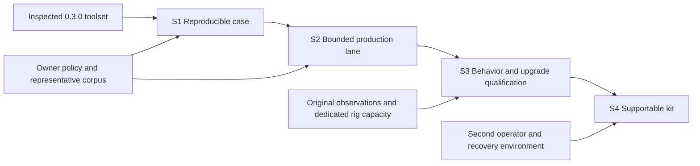

# Strategic roadmap: four outcome-gated releases

**S1 outcome accepted 2026-10-25:** the bounded RC8 local-new-game workflow is complete; see
[S1_COMPLETION_REVIEW.md](S1_COMPLETION_REVIEW.md) for implementation, real both-layout qualification, independent
agent resume, approved controlled compilation pilot and the owner's baseline acceptance. Human active-review time
is explicitly NOT_MEASURED in that accepted baseline. This does not establish S2 optimization, save upgrades,
publication, or S4 independent-human/support outcomes. Earlier dated proposal/status notes below remain history.

**Current implementation checkpoint, 2026-10-25:** S1's bounded RC8 local-new-game baseline is accepted. S2 has an owner-accepted opt-in parsing-cache tradeoff and a validated read-only production portfolio; S3 has case-bound obligations, strict scenario observations and exact comparison; S4 has private case exchange and a verified local code kit. See [implementation plan](S_SERIES_IMPLEMENTATION_PLAN.md), [S2 production evidence](S2_PRODUCTION_PORTFOLIO.md), [S3 comparison guide](S3_COMPARISON_GUIDE.md) and [S4 workstation trial](S4_WORKSTATION_TRIAL.md). None of these narrower results completes S2-S4 acceptance. Save/gameplay changes, independent-human trial, support commitment and publication retain their gates.

Proposed 2026-10-17 for owner review. Read [VISION.md](VISION.md) for the destination and boundaries and
[ARCHITECTURE_GAPS.md](ARCHITECTURE_GAPS.md) for the inspected evidence behind the choices.
This document sets direction over approximately 12-24 months; it does not allocate dates or imply approved staffing.
S1-S4 are substantial product releases, not proposed Semantic Versioning numbers or calendar quarters.

Factual status 2026-10-18 (no change of direction): S1-S4 themselves are not implemented. The item 75 contracts this document
reuses (R1 run manifests, R2 scan registry, R5 `revise`, R6, R8) and DOC-001 were implemented offline that day with live gates
pending; see [ROADMAP_STATUS](ROADMAP_STATUS.md).

## Strategic choice

BridgeForge has accumulated powerful tools faster than it has established a common operator workflow. The next
investment should turn those tools into a reproducible revival system, then improve its bounded automation and
the depth of qualification. Portability and wider adoption follow demonstrated local operation.

The strategy is deliberately not "finish every existing roadmap item, then add more checks." Items 70/73/75 supply
important implementation requirements, but they are means to these outcomes. A sub-item can remain deferred without
blocking a release unless it is needed for that release's acceptance. No broad auto-acceptance is needed for S1.

## Release sequence and the next three outcomes

| Release | Outcome the operator gains | Architectural center | Prior condition |
|---|---|---|---|
| S1: Reproducible Revival Case | Continue a case from preserved input to exact qualified candidate without reconstructing command/state history | Workspace adapters, candidate identity, evidence/decision receipts and a shared qualification flow | Approve the initial cohort and evidence contracts |
| S2: Bounded Revival Production Lane | Process a supported cohort with less repeated owner/agent work and measurable abstention | Shared resolution context, governed recipe/ruling reuse and portfolio measurement | S1 identities, policy boundaries and usable workflow |
| S3: Behavior and Upgrade Qualification | Maintain revivals across campaign lifecycle and supported upgrades with visible lost features and deviations | Scenario families, behavior obligations, saved-state lineage and impact-driven requalification | S1 provenance and S2 analysis/resolution; original/runtime evidence access |
| S4: Supportable Revival Kit | A second operator can install, recover, reproduce and maintain the supported workflow on a declared environment | Supported contracts/configuration, recovery, versioned compatibility knowledge and stable packaging | Demonstrated S1-S3 outcomes and an owner-approved support commitment |

### S1. Reproducible Revival Case

**Intended outcome and user benefit:** one case explains what was received, which source/dependency authority was
selected, what changed and why, which exact candidate was exercised, what remains unresolved, and what can be shipped
within the applicable policy. A maintainer resumes it after interruption without manually reconciling two workspace
forms or mistaking a previous run for the current candidate.

**Major capabilities and architectural changes:**

- A logical case descriptor adapts both implemented workspace dialects without relocating originals or renaming working
  trees. Existing tools remain usable; one documented operator flow coordinates them.
- Versioned candidate/input/environment identities and validation receipts connect scan, build, review, rig run and
  package. Legacy records remain readable with explicit provenance limits.
- Qualification has explicit requirements and applicability for the candidate's scope, with one policy evaluation used
  by the selected operator-facing archive/release flow. Preserve local-only versus distributable distinctions.
- A minimal prepare/test/finalize lifecycle prevents version bumps or report writes from invalidating the tested
  candidate at finalization. Resume and stale-input behavior are part of the usable feature, not later housekeeping.

**Dependencies/prerequisites:** representative owner-authorized cases, preserved originals, available core/dependencies,
the workspace/scan/build/live/release APIs in evidence E03-E12, and bounded portions of item 75 R1/R2/R5/R7.
S1 does not require all R1-R8 features or the full automation plan.

**Risks/unknowns:** compatibility costs of two layouts; differences in existing gate semantics; hashes of irrelevant
report changes; large-input fingerprint cost; unavailable compile/runtime dependencies; caller/API compatibility.
Keep the first supported cohort narrow and explicitly map existing policies before changing their enforcement.

**Objective acceptance:**

1. The pilot matrix in [NEXT_MILESTONE.md](NEXT_MILESTONE.md) passes on both workspace forms. A second reader can
   reproduce the candidate's reasoning/status from its case artifacts and documented commands without chat context.
2. Eligible cases reach qualification without manually editing status/manifest files; ineligible cases retain concrete
   missing evidence/decision reasons. Source/API compatibility is preserved or migrated explicitly, not silently.
3. Dependency/core/candidate changes invalidate relevant evidence. Wrong logs, old runs, missing tools, unknown old
   provenance and post-test mutation cannot manufacture an accepted current candidate.
4. Failure-injection tests demonstrate safe retry and preservation of originals/prior archives. The produced artifact
   is linked to the qualified candidate; no finalization mutation changes the tested file set.
5. At least one eligible pilot completes its applicable real rig scenario and exact-build acceptance; a deliberate
   drift negative control is refused. A save-changing pilot cannot claim upgrade qualification from this test.
6. Record baseline operator steps, active review time, elapsed qualification time and unresolved handoffs by case.
   The owner approves this operational baseline before S2 automation targets are set.

**Deferred:** expanding fixers, E2 auto-acceptance, universal workflow/state migration, semantic dependency solver,
all historical save migrations, UI generalization, public distribution and additional target versions.

### S2. Bounded Revival Production Lane

**Intended outcome and user benefit:** a maintainer can process a declared cohort as a portfolio of cases, spending
judgment once where conditions really match and retaining explicit exceptions elsewhere. Agent work becomes a source
of reviewed deterministic recipes rather than an ever-growing collection of one-off edits.

**Major capabilities and architectural changes:**

- A reusable resolution snapshot supplies scan, compile and qualification with selected providers, class/source
  authority, transitive dependencies, target identity and unresolved conflicts. Incrementally reuse existing facts;
  do not require a new whole-program intermediate representation.
- Measure a fresh cohort and categorize actual blockers. Add recipes for observed recurring shapes, with executable
  preconditions, refusals, regression examples and promotion evidence. Draft descriptions/translations with source
  provenance and owner review through existing Project Go-compatible conventions.
- Govern decisions and standing rulings by semantic predicates, contradictions, expiry/revocation and affected-case
  invalidation. New contexts abstain; superficially similar finding text is insufficient.
- Implement portfolio orchestration and resumable jobs over case receipts; indexes are rebuildable views. Agent
  adapters are optional and replaceable. Enable eligible auto-application only after the item 75 R3/R4 gates pass.
- Extend existing local concurrency with measured analysis reuse, change-driven recomputation, bounded resource
  scheduling and input-bound recovery. Start with independent read-only mod analysis; preserve ordered mutations and
  independent qualification. Agent-ready scope and acceptance: [execution efficiency plan](EXECUTION_EFFICIENCY_PLAN.md).

**Dependencies/prerequisites:** S1's usable case/evidence contracts; a fresh baseline; rights to use a representative
private corpus; maintenance/review capacity; a held-out evaluation set. Reuse item 73 A/C/D/E and selected B work,
not an indiscriminate implementation of every proposed fixer.

**Risks/unknowns:** overfitting to already-fixed mods; suppressing features to clear checks; changed scanner rules
inflating gains; inappropriate ruling transfer; model variability/cost; dependency coverage mistaken for behavior.
Reserve holdout cases before tuning and record scanner/policy versions in every comparison.

**Objective acceptance:**

1. Before implementation, agree a cohort with represented classes and separate holdout cases. Publish denominators,
   exclusions and missing evidence; historical stored scans are not the baseline.
2. For every supported recipe/ruling, positives, refusal cases, idempotence, compilation applicability and ownership
   constraints are tested. No holdout MANUAL/UNKNOWN, balance or save-changing case is applied without its required person.
3. Three consecutive portfolio runs with identical inputs/policy select the same deterministic work and resumable
   outcomes; interrupted work does not duplicate or lose applied changes. Agent outputs need not be identical, but
   every accepted result must satisfy the same independent evidence/policy contract.
4. Active repeated review work falls on the agreed comparable cohort, with the magnitude and uncertainty reported;
   the owner sets the worthwhile improvement threshold from S1 data before S2 begins. Do not invent a percentage now.
5. All sampled auto-applied cases survive independent review with no unapproved feature loss; discovered false
   acceptances block expansion and reopen affected cases. Abstention and unsupported cases remain visible.
6. Qualified-candidate yield, escaped regressions and pending live work are reported separately from scanner clearance.
7. On the agreed workload/hardware, compare repeated serial, cold/warm and bounded parallel runs. Normalized findings
   and qualification decisions agree; stale cached inputs are rejected and cancellation/worker failure is recoverable.
   Report memory, elapsed time and resource contention; the owner sets worthwhile gains from measured baselines before
   defaults change. Existing `--jobs`/`--parallel` support is a starting point, not proof this acceptance already passes.

**Deferred:** broad autonomous repair of unknown code, automatic gameplay restoration/balance, a public plugin
marketplace, optimization of every queue outlier, mandatory cloud models, generic distributed workers and universal
dependency solving. Unattended schedules remain dedicated-rig reporting only under existing owner policy.

### S3. Behavior and Upgrade Qualification

**Intended outcome and user benefit:** a revival can be maintained after initial boot. The operator can explain
important preserved/changed features, test selected campaign/combat/integration paths, and qualify a supported
existing-save upgrade without treating XML/class resolution as load/save/reload proof.

**Major capabilities and architectural changes:**

- Relate discovered features, lifecycle/persistence risks, expected changes and qualification scenarios to the case.
  Extend the existing D-series, scenario and change-impact tools instead of replacing them with an opaque AI summary.
- Curate reusable scenario families: generation, colony/economy, combat callbacks, dependency integration, long-running
  campaign activity and upgrade/reload. Select families by evidence-backed change impact; unknown impact requires
  broader testing or a stated unresolved boundary.
- Record original/reference observations when feasible, candidate observations, expected deviations and unavailable
  baselines. Missing source or an unavailable old game means bounded qualification, not a fictional equivalence claim.
- Maintain save lineage and assertions for idempotence, ownership, persistent identities and removed entities. Expose
  observation and coverage gaps. Consume optional SPW reports only under their exact-input/comparability contract.
- Connect recurring runtime failures to checks/recipes, validating new check precision on healthy controls as well
  as reproductions. Lost-feature recreation remains a separate owner choice, not an automatic pipeline stage.

**Dependencies/prerequisites:** S1 manifests and live identity; S2 resolution/recipe provenance; legal/access-compatible
original reference material; scenario corpus; bounded rig time and human observation. Item 75 R6 and item 72 E3/E4
are ingredients, alongside the existing D-series and probe—not replacements for them.

**Risks/unknowns:** no reference runtime, flaky GUI, nondeterministic events, long scenario duration, instrumentation
changing behavior, combinatorial mod interactions, incomplete save invariants and uncertainty about intended behavior.
Use repeatable seeds/setup where evidenced, healthy and deliberately broken controls, and scenario-specific confidence.

**Objective acceptance:**

1. An owner-approved representative set includes content-only, loose-script, jar-bearing and persistent-campaign cases.
   Each declared supported scenario family has at least one passing healthy control and one detected known-bug control.
2. Every selected critical feature has observation evidence, an approved deviation, or an explicit unsupported/unknown
   result. Unknown is never counted as preserved; counts-only static coverage is never converted into a proof percentage.
3. Supported upgrade cases complete copied old-save load, migration where authorized, save, restart/reload and repeat;
   ownership, identities and removed-state assertions hold. No primary/player save is modified by the qualification tools.
4. A planted regression in a covered family is detected and linked to the changed case input; a changed provider or
   rule reopens affected evidence. Unsupported interactions are reported rather than extrapolated from a small matrix.
5. The operator receives a residual human test list and a qualified-scope report distinguishing new-game, campaign,
   combat, save and integration outcomes. Packaging cannot broaden that scope.

**Deferred:** proof of whole-game equivalence, exhaustive mod combinations, universal save repair, automatic recreation
of undocumented features, complete UI automation and replacing SPW's profiling/attribution responsibilities.

### S4. Supportable Revival Kit

**Intended outcome and user benefit:** BridgeForge is maintainable outside its original workstation. A second operator
can install the supported toolchain, import or start a case, reproduce its conclusions, restore required local state,
and understand which target/environment combinations are supported.

**Major capabilities and architectural changes:**

- Stable local configuration and explicit offline-analysis versus live-run support tiers; clean-machine onboarding and
  a compatibility/deprecation policy for commands, schemas, profiles and recipes.
- A maintained reference target with versioned core/API facts and resolved dependencies. Evaluate a second target only
  when its owner-approved support investment, legal inputs and qualification corpus exist. It is not required for S4.
- Portable case exchange with private payload separated from shareable evidence and license restrictions; raw mod/save
  data never becomes an assumed GitHub fixture or public attachment. Sister tools consume stable versioned artifacts
  and degrade gracefully when evidence/tool versions are unsupported.
- Recovery exercises for irreplaceable state and rebuildable indexes; stable product packaging/setup and an operational
  support guide. Prior local-only policy is preserved through export, restore and downstream use.

**Dependencies/prerequisites:** S1-S3 outcomes, a second operator and machine/environment, retention/storage policy,
support capacity and owner decisions about supported platforms and distribution. Reuse item 64, item 75 R8 and
existing state snapshots; do not introduce a hosted service as a shortcut to portability.

**Risks/unknowns:** migration of absolute paths, unavailable historical assets, maintenance cost across Python/JDK/game
versions, licensing constraints, schema drift and lack of a second operator. If these resources are absent, keep the
release explicitly local-maintainer-supported rather than claiming community-ready operation.

**Objective acceptance:**

1. A second operator on a fresh declared environment completes S1's supported flow from documented inputs without
   undisclosed owner paths, local hooks or chat. Manual setup steps are documented and measured.
2. Isolated restore verifies required hashes, handles incomplete/corrupt snapshots safely, reconstructs configuration,
   rebuilds indexes and reproduces one declared qualification scenario without replacing the primary workspace.
3. Representative older artifact/schema fixtures remain readable or produce actionable migration/refusal messages;
   invalid receipts/identities and unsupported profile versions cannot acquire current acceptance on import.
4. Each supported profile has an evidence-backed support statement and regression process. Offline CI portability
   and actual live-driver qualification are stated separately.
5. License/local-only restrictions, credits and explicit publication authorization survive packaging/exchange. The
   owner signs off the support commitment and release scope; the tooling does not infer this from a green CI run.

**Deferred:** public SaaS, general mod manager/GUI, multi-game abstraction, unlimited target support, arbitrary untrusted
agent execution and public compatibility-knowledge crowdsourcing without governance.

## Work backward: critical path and investment choices

The destination requires a second operator to reproduce a qualified maintained revival. That requires a portable
case and recoverable evidence (S4), which requires demonstrated lifecycle/upgrade obligations (S3), which requires
repeatable environment and decision selection (S2), which requires a single identifiable case and candidate (S1).

The near-term critical path is:

1. Owner approves supported scope, pilot access and the difference between a local archive and public distribution.
2. Define case/workspace/evidence boundaries and map existing policies; adapt rather than rewrite.
3. Demonstrate intake-to-qualified-candidate with real identity, interruption and stale-evidence behavior.
4. Measure the operator baseline, then select the recurring work worth automating.
5. Add behavior/upgrade depth and prove transfer/recovery before widening the support promise.

Fingerprinting, validation outcomes and archive safety matter because they enable this path. They are not the whole
strategy. Conversely, new scanners, polished reports or more agent capacity cannot substitute for the case lifecycle.

## How this changes existing priorities

| Existing work | Strategic treatment |
|---|---|
| Items 70/75 trust refinements | Pull only the contracts/operations needed for each release; maintain their safety rules; do not wait for all cleanup to finish |
| Item 73 description/ruling/recipe work | Highest-value candidates for S2 after a fresh comparable baseline, not automatically first because historical counts were large |
| Item 73 E2 | Defer activation until S1 and demonstrated eligibility gates; a useful S1 can require human review throughout |
| Item 72 lost features | Detection/qualification supports S3; expensive re-creations require separate owner scope, license and acceptance |
| D-series and existing save tools | Invest in real original/candidate observations and reusable scenarios rather than reimplementing already-present offline analysis |
| Broad refactors | Extract only seams required by case/evidence/qualification convergence; retain CLI/artifact compatibility tests |
| Additional game versions, launchers and sister integrations | Support explicit owner demand through qualified profiles/artifact contracts; avoid multiplying the matrix before baseline operation is reproducible |

## Capacity, release decisions and reassessment

No evidence establishes engineering headcount, review availability, budget or rig hours. The horizon is a planning lens,
not a delivery promise. Before scheduling, estimate S1 from a bounded discovery/pilot, identify maintainer, reviewer and
rig-owner responsibilities, then allocate actual capacity. Do not extrapolate a burst of commits into a sustainable rate.

At each release gate, review operator outcomes, false acceptances, unsupported cases, active review time, qualification
cost and remaining operational risks. Freeze the cohort/thresholds before evaluating the release. Expand only when the
current lane is sustainable; reduce breadth rather than weaken gates. Maintenance/security/correctness work continues
as enabling work, with a bounded budget chosen from real capacity, not another competing strategic release stream.

Human approval is required for release/cohort scope, support commitments, semantic deviations, save-changing repairs,
license/distribution decisions, target expansion and any changed autonomy policy. This proposal starts no implementation.
The next substantial objective is specified in [NEXT_MILESTONE.md](NEXT_MILESTONE.md).
