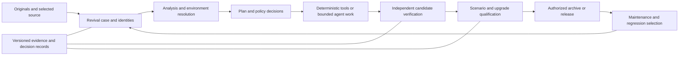

# BridgeForge long-term vision

Proposed strategy for owner review, 2026-10-17. Planning horizon: approximately 12-24 months, expressed as four
outcome-gated releases rather than dated commitments. No development capacity or dedicated rig budget has been established.
Application source is unchanged by this planning exercise. Baseline inspected: `3342654d`.

## Purpose and destination

BridgeForge should become a local, evidence-driven engineering workbench for reviving and maintaining legacy
Starsector mods: it preserves what was received, understands enough to choose a defensible intervention, performs
authorized repeatable work, exposes unresolved judgment, and qualifies the exact result for its declared use.

Its unit of success is a maintained revival with a reproducible explanation and bounded compatibility evidence.
It is not the number of scanner rules, commands, files changed, findings suppressed, or agents dispatched.
A correct refusal or an explicit unresolved feature can be a successful engineering outcome; an unjustified clean
scan cannot establish that a mod was faithfully revived.

The original author's intent, identities, credits and save compatibility remain first-class constraints.
Owner-requested redesigns must be identifiable departures from restoration, not silently classified as compatibility fixes.

The [project charter](PROJECT_CHARTER.md), local `AGENTS.md`, committed `CLAUDE.md`, and
[dependency strategy](DEPENDENCY_STRATEGY.md) retain authority. This vision proposes a delivery strategy; it does not
expand permissions, redefine SAFE, or authorize implementation, publication, gameplay changes or save mutations.

## Who it serves

The primary operator is an experienced mod revival maintainer or repository owner. Agents are replaceable workers
within that operator's policy, not independent arbiters of correctness. A contributor must eventually be able to
continue an existing revival without reconstructing decisions from chat or knowing the owner's directory layout.

Players benefit through better preserved mods, clearer limitations, and safer upgrade instructions. A consumer-facing
mod manager, general desktop GUI or hosted multi-user service is not required to deliver that benefit.

## Capabilities required at the destination

| Capability | What the operator must be able to do |
|---|---|
| Preserve and identify | Identify originals, selected source authority, dependencies, candidates and published artifacts by content, not just names/versions |
| Carry a revival case | Resume one case from intake to qualification, retaining decisions and invalidating only evidence affected by changes |
| Understand sufficiently | Connect source, compiled classes, data IDs, lifecycle registrations and persistent state; identify missing features and unsupported analysis explicitly |
| Resolve an environment | Know which classes/assets/IDs the actual enabled mod set supplies, including shadowing and transitive dependencies |
| Repair under policy | Apply approved deterministic transformations and send bounded judgment work to humans or agents; refuse unsupported cases |
| Verify independently | Evaluate candidate changes using tools and scenario observations, independently of the worker's explanation |
| Qualify function and upgrades | Test representative new-game, campaign, combat, integration and copied-save upgrade scenarios according to declared scope |
| Explain and maintain | Explain what changed, what remained unknown, what was observed, and what later changes require requalification |
| Operate sustainably | Reproduce the workflow on a supported machine, recover state, and use stable versioned artifacts across sister projects |

This is a capability set, not a requirement to solve arbitrary legacy code. Reflection, missing source, undocumented
internals, licensing uncertainty and unavailable original runtimes remain legitimate escalation or exclusion boundaries.

## Target architecture

Keep a modular Python application with explicit local artifacts and a separately built Java probe. Retain the existing
CLI, scanners, fixers, build tools, indexes and rig mechanisms. Introduce shared contracts at their boundaries, then
adapt workflows incrementally. A repository-wide rewrite, service decomposition or mandatory database migration is
not justified by the evidence gathered so far.

The case is an orchestration and provenance boundary, not a replacement parser or a new universal mod model.
It references existing artifacts. The evidence layer records applicability and uncertainty; it does not reduce all
validation to one PASS field. File-based records remain authoritative initially. Search indexes may be rebuilt.
The existing two workspace layouts must be supported through explicit adapters before any deprecation is considered.

Target/environment profiles should ultimately identify the exact game core, compiler/runtime, libraries and launcher
conditions. Today RC8/Java 17 is the reference target. A configurable version string does not establish support for
another game build. Additional target support needs its own corpus, API evidence, live qualification and owner approval.

## What the next three releases should change

1. **S1: a reproducible revival case.** The operator follows one coherent workflow across the existing workspace forms
   and obtains a candidate whose approvals and qualification can be traced to exact inputs. Interruptions and changed
   inputs do not silently preserve old acceptance.
2. **S2: a bounded revival production lane.** A measured, supported cohort moves through repeatable repairs and reviewed
   exceptions with substantially less repeated owner work. Validated recipes and conditional rulings accumulate;
   automation abstains on unfamiliar or high-risk cases.
3. **S3: maintained behavior and upgrade qualification.** Revival quality includes selected original behaviors,
   important integrations and upgrade scenarios, with explicit lost features, approved deviations and unobserved paths.

S4 makes those outcomes supportable beyond the original workstation and maintainer: portable setup, documented support
boundaries, recovery proof, and stable artifact contracts. See the [strategic roadmap](STRATEGIC_ROADMAP.md).

## Product and repository boundaries

- Keep the real install and original inputs read-only. Work on copies; publish only within recorded permissions.
- Keep confidence, automation tier and whole-case complexity separate. Compilation, static analysis, package integrity,
  dependency resolution, API compatibility, save compatibility and observed behavior remain distinct evidence axes.
- Keep live execution opt-in and rig-contained. A controlled rig is operational isolation, not a security sandbox for
  hostile mod code. Broader untrusted-service execution would require a separate security design and approval.
- Keep SPW independent and responsible for profiling/attribution. BridgeForge may consume versioned performance evidence,
  not grow another profiler or make automatic performance claims from a boot log.
- Keep Salvor responsible for player-facing save recovery/editing, Project Go for translation, and VoidSmith for fitting
  and Save Workshop workflows. BridgeForge owns revival evidence and mod qualification, not those products' interfaces.
- Keep RevenantLib a separately governed compatibility dependency under the existing fold-in and licensing policy;
  it is not a default destination for maintained libraries, content mods or arbitrary rewritten behavior.
- Keep useful offline operation independent of an AI vendor, cloud account, sister project or continuously running service.

## Deliberate exclusions for this horizon

No multi-game platform, public mod marketplace, general player save editor, generic runtime profiler, full-game
simulation, whole-program proof of behavioral equivalence, arbitrary decompiler-driven rewriting, autonomous gameplay
redesign, public agent execution service, or general desktop GUI. Do not pursue broad OS live-run parity or support
every historical Starsector release as implied consequences of portable offline tooling.

No requirement to restore every abandoned feature. First establish what was lost and whether restoration is feasible,
licensed and desired. Recreation remains a separate owner-approved project, with scope and acceptance of its own.

## Success measures and decisions

Measure time to a **qualified** candidate, active owner review time, repeat work avoided, supported-cohort completion,
abstention/refusal reasons, reproducibility, escaped regressions and upgrade preservation. Report cohort composition,
sample sizes and uncertainty. Keep mechanical completion separate from live qualification and actual distribution.
No current throughput or precision baseline justifies a percentage improvement promise yet.

The owner must approve the four-release scope, initial supported cohort, available engineering/reviewer/rig capacity,
license/distribution posture, evidence retention limits, and any expansion beyond the reference target. The same person
may fill several roles; that is a capacity constraint, not evidence that the roles have no cost.

Reduce cohort breadth or automation ambition if resources are insufficient; do not reduce evidence requirements to
make a nominal release date. Reassess after S1's measured pilot. Strategy completion is a sequence of demonstrated
operator outcomes, not the passage of 12 or 24 months.

Evidence and assumptions: [architecture assessment](ARCHITECTURE_GAPS.md). First execution proposal:
[next milestone](NEXT_MILESTONE.md). Existing tactical specifications remain in
[item 75's handoff](ROADMAP_IMPLEMENTATION_HANDOFF.md) and the [automation plan](AUTOMATION_PLAN.md).
